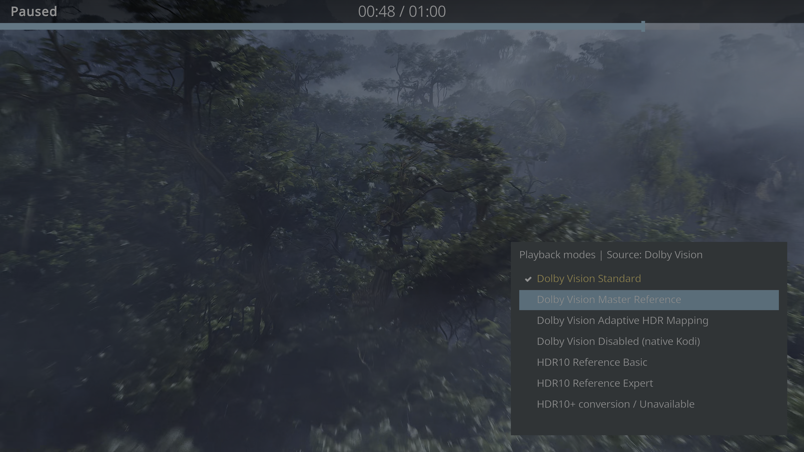
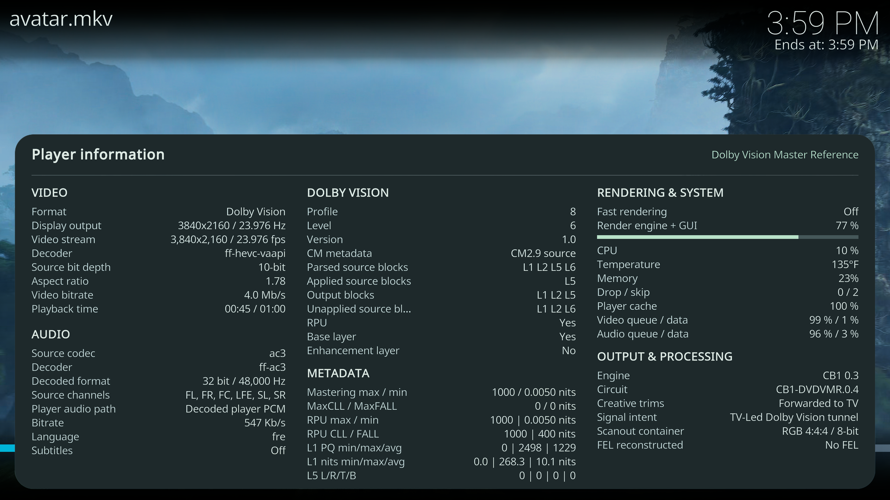

# LibreELEC with Dolby Vision, HDR10+ and AMD 3D support

Dolby Vision playback and HDR10/HDR10+ output in Kodi, powered by **CB1**, an
open-source Dolby Vision processing engine. Supported Intel, AMD and NVIDIA
GPU families are listed below. One Generic image includes both NVIDIA driver branches.

**R1.0.0 RC1** · LibreELEC 13 · Kodi 22 RC1 · CB1 0.3

[R1.0.0 RC1](https://github.com/CroqueMr/libreelec-x86-DV/releases/tag/R1.0.0-RC1)
is available as an installation image and a LibreELEC update archive.

[Downloads](https://github.com/CroqueMr/libreelec-x86-DV/releases)
· [Release notes](docs/cb1/RELEASE.md)
· [Report an issue](https://github.com/CroqueMr/libreelec-x86-DV/issues)

No external player or proprietary Dolby SDK is required.

## Supported Dolby Vision profiles

| Profile | Support |
| --- | --- |
| 5 | Yes |
| 7 MEL | Yes |
| 7 FEL | Yes, including enhancement-layer reconstruction |
| 8.1 / 8.2 / 8.4 | Yes |
| 10 | Yes |
| 9, legacy profiles, 20 | No |

CM2.9 and CM4 metadata are supported. Mode availability depends on the source
format and the active output capabilities.

## Rendering modes

| Source | Mode | Output | Purpose |
| --- | --- | --- | --- |
| Dolby Vision | **Dolby Vision Master Reference** | Dolby Vision, TV-Led | State-of-the-art Dolby vision output more precise than any device certified by Dolby |
| Dolby Vision | **Dolby Vision Standard** | Dolby Vision, TV-Led | Prioritize performance with near-imperceptible image differences |
| Dolby Vision | **Dolby Vision Adaptive HDR Mapping** | Dolby Vision, TV-Led | Expand highlights and selected midtones for the configured TV, guided by source metadata |
| Dolby Vision | **HDR10 Reference Basic** | HDR10 | Convert using source mastering information and scene guidance, without TV configuration |
| Dolby Vision | **HDR10 Reference Expert** | HDR10 | Map to the configured TV peak and gamut using compatible creative metadata |
| Dolby Vision | **HDR10+** | HDR10+ | Generate frame-owned dynamic output metadata from the Dolby Vision source |
| Dolby Vision | **Dolby Vision Disabled (native Kodi)** | Native Kodi output | Use Kodi's original playback and fallback behavior |
| HDR10 | **Dolby Vision Reference (AI)** | Dolby Vision, TV-Led | Generate L1/L3 scene metadata using image analysis and LightGBM, without an enhancement grade |
| HDR10 | **Dolby Vision Adaptive HDR Mapping (AI)** | Dolby Vision, TV-Led | Combine AI scene metadata with controlled highlight expansion |
| HDR10 | **HDR10 Native** | HDR10 | Keep native Kodi HDR10 playback |
| HDR10+ | **Native** | HDR10+ | Preserve authored dynamic metadata on an admitted deep-colour output |
| SDR / HLG | **Native** | Native SDR / HLG | Keep native Kodi playback |

Adaptive HDR Mapping and HDR10 Expert require a TV profile. Standard, Master
Reference, Basic and Reference AI do not.

For metadata use, curves and mode differences, see [processing and algorithms](docs/cb1/PROCESSING.md).
The [Master Reference / Standard comparison](docs/reports/master-reference-vs-standard-2026-10-21.md)
contains the retained Beta5 image and GPU measurements.

### Quick rendering selection

Change rendering mode during playback. The bottom-right menu shows the choices
for the current source and explains unavailable modes.

Press **O** to cycle through **Player information**, **rendering selection** and
**video only**. Play/pause and seek remain available with either panel open.

### Player information

Source and output formats, Dolby Vision profile, CM version, BL/EL/FEL status,
metadata, active rendering mode and supported GPU render-engine usage.
HDR10 and SDR show their relevant information without empty Dolby Vision sections.

GPU usage is Kodi's render-engine load, including visible menus. It is not total
GPU or video-decoder load. [Controls and settings](docs/cb1/PLAYBACK.md).

## HDR10+

| Source | Output | Processing |
| --- | --- | --- |
| HDR10+ | HDR10+ | Preserve the original picture and its frame-associated dynamic metadata |
| Dolby Vision | HDR10+ | Reconstruct the source, including FEL, and generate HDR10+ statistics and compatible luminance guidance |

Supported on the listed Intel, AMD and NVIDIA driver routes, with a compatible
HDR10+ display and at least 10-bit output. Kodi reports HDR10+ display capability,
source format and accepted output separately. HDR10+ to Dolby Vision is not included.
[HDR10+ processing](CB1/docs/HDR10PLUS.md) · [Driver/output support](docs/cb1/DRIVER-COVERAGE.md).

## Install or update

Choose the matching version from [releases](https://github.com/CroqueMr/libreelec-x86-DV/releases):

| File | Use |
| --- | --- |
| `.img.gz` | Write to installation media for a fresh installation |
| `.tar` | Copy into LibreELEC's update directory and reboot |
| `sources.tar.zst` + `vendor-inputs.tar.zst` | Rebuild the release; not required for installation |

Settings are in **Kodi > Settings > Player > Videos**.
Standard Dolby Vision is the default. Each mode has one fixed rendering recipe.
Automatic Master-to-Standard recovery is off by default. [Build instructions](docs/cb1/BUILD.md).

## AMD HDMI 3D

| Source | Playback |
| --- | --- |
| MVC Blu-ray ISO | Decode both views and use HDMI frame packing on compatible displays |
| Side-by-side / top-and-bottom | Native Kodi stereoscopic playback and output selection |
| 1080p half-SBS | Additional HDMI stereo modes at 24, 50 and 60 Hz |

3D uses Kodi's native playback path, not CB1 conversion or Adaptive processing.
A 3D-capable display and suitable glasses are required.
[3D setup and compatibility](docs/cb1/3D.md).

## Hardware

| Hardware | Dolby Vision support |
| --- | --- |
| Intel iGPU: Core 7th gen and newer, Core Ultra Series 1 / 2, N-series | Supported |
| AMD iGPU: Ryzen 2000G / 3000G and corresponding mobile APUs, 4000 / 5000 APUs, 6000, 7030 / 7035, 7040 / 8040, 8000G, AI 300 | Supported |
| AMD dedicated GPU: Radeon RX 5000 / 6000 / 7000 series | Supported |
| AMD Radeon Vega M; Intel Arc A / B | Supported |
| NVIDIA dedicated GPU: GeForce GTX 16, RTX 20 / 30 / 40 / 50 series | Supported |
| NVIDIA GeForce GTX 10, Pascal | Supported; matched R580 driver selected automatically |
| Other hardware | Dolby Vision processing to HDR10 where supported; no custom Dolby Vision HDMI output |

Performance depends on hardware, content and rendering mode. Prior N100 tests
covered Master Reference with 4K FEL remuxes and 4K60 content.
Heavier conversions require more GPU performance.

For problems, open an issue with the exact CPU/GPU, display, connection chain,
build version and `kodi.log`. [Hardware details](docs/cb1/HARDWARE.md).
The [driver/output matrix](docs/cb1/DRIVER-COVERAGE.md) distinguishes DV V1/V2,
HDR10/HLG, native HDR10+ and converted HDR10+, including route-specific limits.

## Known limitations

- Screenshots are unavailable in Dolby Vision Master Reference.
- Heavy conversions and visible menus can exceed N100 rendering capacity, especially at 60 FPS.
- Adaptive HDR Mapping remains subject to visual refinement.
- Intel Display9, including Kaby Lake and Coffee Lake: native HDMI HDR10/HLG/HDR10+ is not supported. Dolby Vision uses its separate tunnel path.
- NVIDIA GTX 10/16 and RTX 20/30: some HDMI-VIC, stereoscopic or vendor-packet combinations prevent native HDR signaling. See the driver/output matrix.

## Components and documentation

[Documentation index](docs/cb1/README.md).

| Component | Role |
| --- | --- |
| Linux display drivers | Dolby Vision signaling, output validation and HDMI transport |
| Kodi | Playback, audio, frame pairing, controls, information and CB1 integration |
| CB1 | Dolby Vision open-source engine: reconstruction, conversion, Adaptive processing and output metadata |
| FFmpeg / libplacebo | Matched metadata, decoding integration and rendering patches |

- [Processing and algorithms](docs/cb1/PROCESSING.md)
- [Playback and settings](docs/cb1/PLAYBACK.md)
- [Hardware support](docs/cb1/HARDWARE.md) and [AMD HDMI 3D](docs/cb1/3D.md)
- [Build](docs/cb1/BUILD.md) and [versions](docs/cb1/VERSIONS.md)
- [Licensing and credits](docs/cb1/LICENSING.md)
- [Upstream LibreELEC README](docs/cb1/UPSTREAM.md)

No affiliation with or certification by LibreELEC, Kodi, Dolby, Intel, AMD or NVIDIA.
