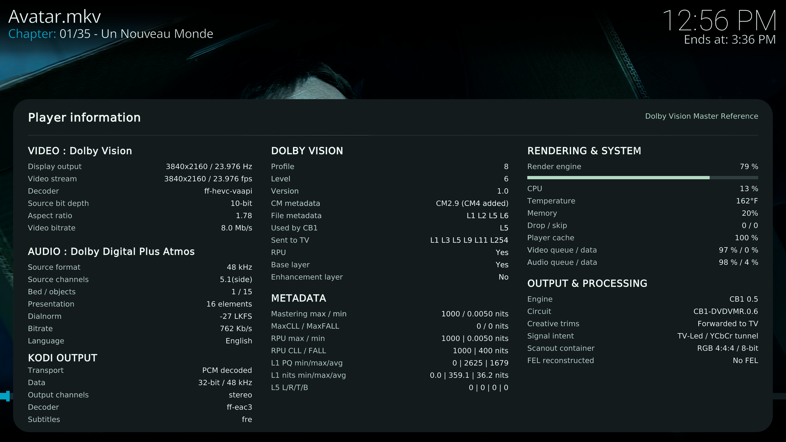
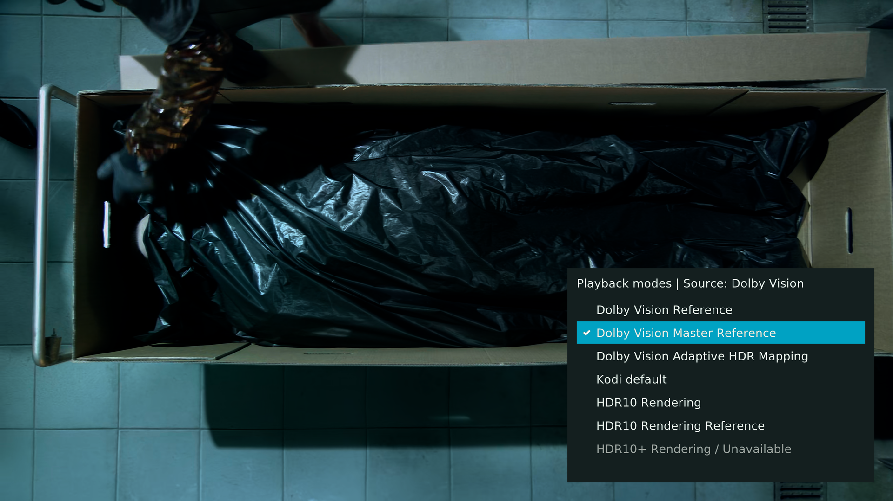
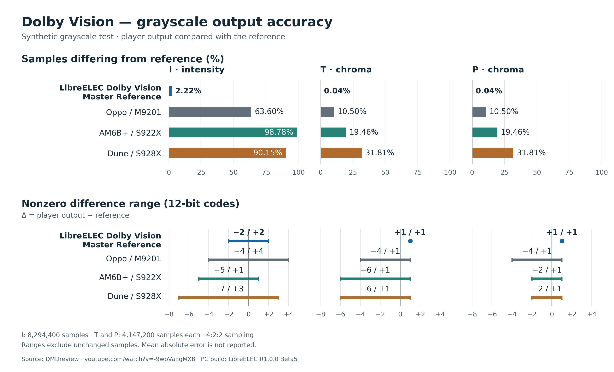

# LibreELEC with Dolby Vision, HDR10+ and AMD 3D support

Dolby Vision playback and HDR10/HDR10+ output in Kodi, powered by **CB1**, an
open-source Dolby Vision processing engine. Supported Intel, AMD and NVIDIA
GPU families are listed below. One Generic image includes both NVIDIA driver branches.

**R1.0.0 RC3** · LibreELEC 13 · Kodi 22 RC1 · CB1 0.5

[R1.0.0 RC3](https://github.com/CroqueMr/libreelec-x86-DV/releases/tag/R1.0.0-RC3)
provides an installation image and a LibreELEC update archive.
Includes improved HDR10 rendering, independent playback preferences, bundled BD-J
runtime and updated Player information.

[Downloads](https://github.com/CroqueMr/libreelec-x86-DV/releases)
 · [Release notes](docs/cb1/RELEASE.md)
 · [Report an issue](https://github.com/CroqueMr/libreelec-x86-DV/issues)

No external player or proprietary Dolby SDK is required.

## Player information

Source and accepted output, active rendering mode, Dolby Vision metadata and
CM2.9/CM4 processing status are shown together. Audio source details and actual
Kodi output are reported separately.

Press **O** to cycle through **Player information**, **Quick Switch** and
**video only**. Play/pause and seek remain available with either panel open.
[Controls and settings](docs/cb1/PLAYBACK.md) · [Audio information](docs/cb1/AUDIO-INFORMATION.md).

## Supported Dolby Vision profiles

| Profile | Support |
| --- | --- |
| 5 | Yes |
| 7 MEL | Yes |
| 7 FEL | Yes |
| 8.1 / 8.2 / 8.4 | Yes |
| 10 | Yes |
| 9, legacy profiles, 20 | No |

CM2.9 and CM4 metadata are supported. Mode availability depends on the source
format and the active output capabilities.
Optional [CM2.9-to-CM4 controls](CB1/docs/CM4-APPEND.md) provide Auto/Auto 2
selection and independent L2-trim removal for Reference and Master Reference.

## Rendering modes

| Source | Mode | Output | Purpose |
| --- | --- | --- | --- |
| Dolby Vision | **Dolby Vision Master Reference** | Dolby Vision, TV-Led | State-of-the-art Dolby Vision output with uncompromised precision |
| Dolby Vision | **Dolby Vision Reference** | Dolby Vision, TV-Led | Optimized Dolby Vision output with imperceptible quality loss, significantly reducing GPU load |
| Dolby Vision | **Dolby Vision Adaptive HDR Mapping** | Dolby Vision, TV-Led | Expand highlights and selected midtones for the configured TV, guided by source metadata |
| Dolby Vision | **HDR10 Rendering** | HDR10 | Convert using source mastering information and scene guidance, without TV configuration |
| Dolby Vision | **HDR10 Rendering Reference** | HDR10 | Map to the configured display peak, black floor and gamut with compatible L2 guidance |
| Dolby Vision | **HDR10+ Rendering** | HDR10+ | Generate frame-owned dynamic output metadata from the Dolby Vision source |
| Dolby Vision | **Kodi default** | Native Kodi output | Use Kodi's original playback and fallback behavior |
| HDR10 | **Dolby Vision Rendering (AI)** | Dolby Vision, TV-Led | Generate L1/L3 scene metadata using image analysis and LightGBM, without an enhancement grade |
| HDR10 | **Dolby Vision Adaptive HDR Mapping (AI)** | Dolby Vision, TV-Led | Combine AI scene metadata with controlled highlight expansion |
| HDR10 | **Kodi default** | HDR10 | Keep native Kodi HDR10 playback |
| HDR10+ | **Kodi default** | HDR10+ | Preserve authored dynamic metadata on an admitted deep-colour output |
| HDR10+ | **Dolby Vision Rendering** | Dolby Vision, TV-Led | Preserve source pixels; use compatible source statistics and labelled estimates when incomplete |
| SDR / HLG | **Native** | Native SDR / HLG | Keep native Kodi playback |

Adaptive HDR Mapping requires a TV profile. HDR10 Rendering Reference has separate
peak, black-level and gamut settings. Reference, Master Reference, HDR10 Rendering
and Dolby Vision Rendering (AI) do not require a TV profile.

**Dolby Vision playback**, **HDR10 playback** and **HDR10+ playback** remember
independent choices. Automatic fallback does not overwrite the next file's saved
choice. **Kodi default** bypasses CB1 image processing for each source type.

For metadata use, curves and mode differences, see [processing and algorithms](docs/cb1/PROCESSING.md).
The [historical Master Reference / Standard comparison](docs/reports/master-reference-vs-standard-2026-10-21.md)
contains the retained Beta5 image and GPU measurements.

### Quick rendering selection

Change rendering mode during playback. The bottom-right menu shows the choices
for the current source and explains unavailable modes.

GPU usage is Kodi's render-engine load, including visible menus. It is not total
GPU or video-decoder load. HDR10 and SDR show their relevant information without
empty Dolby Vision sections.

### Bitmap subtitles and Blu-ray menus

Native Kodi settings provide PGS/DVB brightness, saturation, placement, offset
and size. SDR/PQ authoring controls are separate; disc-menu graphics are excluded.
Blu-ray menus use Kodi/libbluray. RC3 bundles Java and the BD-J JARs matching
libbluray 1.5.0; no separate Java add-on is required. Compatibility depends on
the disc's Java application.
[Subtitle and menu settings](docs/cb1/PLAYBACK.md#bitmap-subtitles-and-blu-ray-menus).

## HDR10+

| Source | Output | Processing |
| --- | --- | --- |
| HDR10+ | HDR10+ | Preserve the original picture and its frame-associated dynamic metadata |
| Dolby Vision | HDR10+ | Reconstruct the source, including FEL, and generate HDR10+ statistics and compatible luminance guidance |
| HDR10+ | Dolby Vision | Preserve source pixels; use compatible source statistics and labelled estimates when incomplete |

HDR10+ output uses the listed Intel, AMD and NVIDIA driver routes, a compatible
HDR10+ display and at least 10-bit output. Kodi reports HDR10+ display capability,
source format and accepted output separately. Metadata-guided HDR10+ to Dolby
Vision is a separate manual mode requiring an admitted Dolby Vision display;
it does not translate authored tone curves.
[HDR10+ processing](CB1/docs/HDR10PLUS.md) · [Driver/output support](docs/cb1/DRIVER-COVERAGE.md).

## Install or update

Choose the matching version from [releases](https://github.com/CroqueMr/libreelec-x86-DV/releases):

| File | Use |
| --- | --- |
| `.img.gz` | Write to installation media for a fresh installation |
| `.tar` | Copy into LibreELEC's update directory and reboot |
| `sources.tar.zst` + `vendor-inputs.tar.zst` | Rebuild the release; not required for installation |

Settings are in **Kodi > Settings > Player > Videos**.
Dolby Vision Reference is the default. Each mode has one fixed rendering recipe.
Automatic Master-to-Reference recovery is off by default. [Build instructions](docs/cb1/BUILD.md).

## AMD HDMI 3D

| Source | Playback |
| --- | --- |
| MVC Blu-ray ISO | Decode both views and use HDMI frame packing on compatible displays |
| Side-by-side / top-and-bottom | Native Kodi stereoscopic playback and output selection |
| 1080p half-SBS | Additional HDMI stereo modes at 24, 50 and 60 Hz |

3D uses Kodi's native playback path, not CB1 conversion or Adaptive processing.
A 3D-capable display and suitable glasses are required.
[3D setup and compatibility](docs/cb1/3D.md).

## Hardware

| Hardware | Dolby Vision support |
| --- | --- |
| Intel iGPU: Core 7th gen and newer, Core Ultra Series 1 / 2, N-series | Supported |
| AMD iGPU: Ryzen 2000G / 3000G and corresponding mobile APUs, 4000 / 5000 APUs, 6000, 7030 / 7035, 7040 / 8040, 8000G, AI 300 | Supported |
| AMD dedicated GPU: Radeon RX 5000 / 6000 / 7000 series | Supported |
| AMD Radeon RX 9000 series | Driver transport implemented; physical HDMI qualification pending |
| AMD Radeon Vega M; Intel Arc A / B | Supported |
| NVIDIA dedicated GPU: GeForce GTX 16, RTX 20 / 30 / 40 / 50 series | Supported |
| NVIDIA GeForce GTX 10, Pascal | Supported; matched R580 driver selected automatically |
| Other hardware | Dolby Vision processing to HDR10 where supported; no custom Dolby Vision HDMI output |

For problems, open an issue with the exact CPU/GPU, display, connection chain,
build version and `kodi.log`. [Hardware details](docs/cb1/HARDWARE.md).
The [driver/output matrix](docs/cb1/DRIVER-COVERAGE.md) distinguishes DV V1/V2,
HDR10/HLG, native HDR10+ and converted HDR10+, including route-specific limits.

Intel HDMI identifies the source as a media player instead of a PC, avoiding LG
automatic PC-mode selection. A driver override retains PC identification when
needed. This change is Intel-specific.

## Known limitations

- HDR/Dolby Vision screenshots illustrate the interface, not HDMI output fidelity.
- Heavy conversions and visible menus can exceed N100 rendering capacity, especially at 60 FPS.
- Adaptive HDR Mapping remains subject to visual refinement.
- Disc-specific BD-J applications and repeated-disc memory behaviour are not universally qualified.
- Some Intel Arc, GeForce GTX 10 and RTX 50 setups still have compatibility reports.
- Intel Display9: the Skylake/Kaby Lake HDR path retains native 12-bit and bandwidth limits; other Display9 and LSPCON routes retain their native restrictions. Physical HDR reception still needs confirmation on the affected setups. Dolby Vision uses its separate tunnel path.
- NVIDIA GTX 10/16 and RTX 20/30: some HDMI-VIC, stereoscopic or vendor-packet combinations prevent native HDR signaling. See the driver/output matrix.

## Components and documentation

[Documentation index](docs/cb1/README.md).

| Component | Role |
| --- | --- |
| Linux display drivers | Dolby Vision signaling, output validation and HDMI transport |
| Kodi | Playback, audio, frame pairing, controls, information and CB1 integration |
| CB1 | Dolby Vision open-source engine: reconstruction, conversion, Adaptive processing and output metadata |
| FFmpeg / libplacebo | Matched metadata, decoding integration and rendering patches |

- [Processing and algorithms](docs/cb1/PROCESSING.md)
- [Playback and settings](docs/cb1/PLAYBACK.md)
- [Hardware support](docs/cb1/HARDWARE.md) and [AMD HDMI 3D](docs/cb1/3D.md)
- [Build](docs/cb1/BUILD.md) and [versions](docs/cb1/VERSIONS.md)
- [Licensing and credits](docs/cb1/LICENSING.md)
- [Upstream LibreELEC README](docs/cb1/UPSTREAM.md)

## Open source. Ahead of commercial players.

DMDreview's measurements place LibreElec Dolby Vision Master Reference mode ahead of the Dolby Vision
players included in the comparison.

*Synthetic grayscale comparison measured by DMDreview on LibreELEC R1.0.0 Beta5. Lower is better.* [Watch the analysis](https://www.youtube.com/watch?v=-9wbVaEgMX8).

Dolby Vision Master Reference and Reference output modes from the build deliver absolute 12 bits precision
with FEL reconstruction, surpassing the best Dolby Vision-certified devices available on the market.

## Performance

[RC3 benchmarks](docs/cb1/BENCHMARKS.md) compare Intel N100 and AMD Ryzen 5 7430U
without the playback GUI. Performance depends on hardware, source and rendering
mode; these measurements do not guarantee every file or visible-menu workload.

No affiliation with or certification by LibreELEC, Kodi, Dolby, Intel, AMD or NVIDIA.
