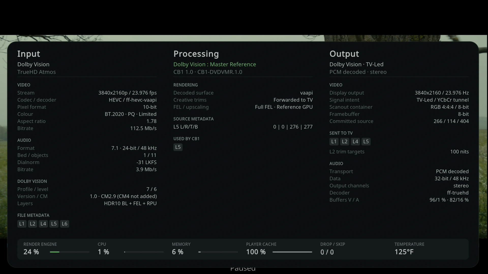
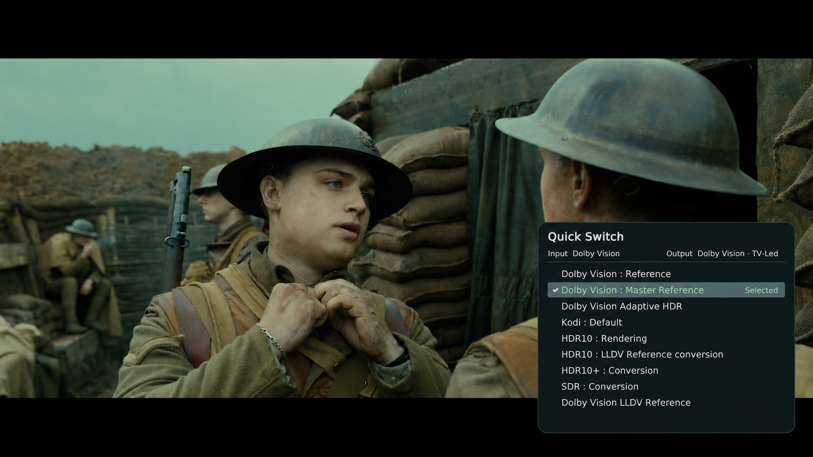
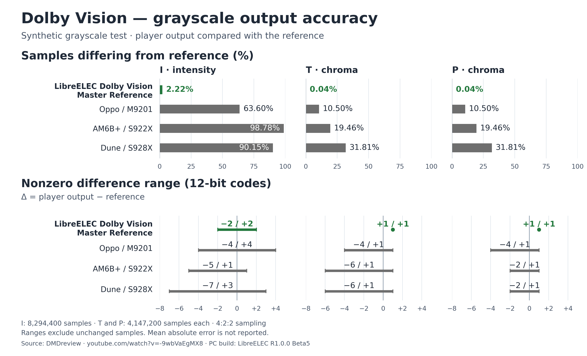

  <picture>
    <source media="(prefers-color-scheme: dark)" srcset="docs/cb1/images/libreelec-cb1-header-thin.png">
    
  </picture> 
  <strong>Dolby Vision without compromise. Full FEL. Native LLDV. Master Reference precision that surpassed the best dedicated Dolby Vision players in independent testing.</strong>

**Powered by CB1, an open-source Dolby Vision engine**, this x86 build plays everything from SDR to Dolby Vision FEL and UHD Blu-ray ISOs, built to preserve the original image and bring the full disc experience to your screen.

- **Full Dolby Vision playback, including FEL, LLDV, CMv4.0** From streaming encodes to UHD Blu-ray remuxes.
- **The most accurate known 12-bit Dolby Vision player.** Master Reference led DMDreview’s tests by a wide margin in precision and fidelity. [See the measurements](#dolby-vision-output-accuracy)
- **Dolby Vision rendering for HDR10 displays.** Full FEL reconstruction and HDR10 calibrated to your display’s peak brightness, black level and gamut.
- **HDR10+ dynamic metadata.** Native HDR10+, Dolby Vision to HDR10+ conversion, and HDR10+ scene data for Dolby Vision output.
- **Native playback and conversions.** Dolby Vision, HDR10, HDR10+, HLG and SDR for TVs and projectors.
- **Full Blu-ray menus.** HDMV and BD-J on Blu-ray and UHD ISOs, with chapters, extras, audio and subtitles.
- **Blu-ray 3D over HDMI.** MVC frame packing on compatible systems, plus side-by-side and top-and-bottom.
- **On-the-fly picture controls.** Switch circuits, inspect HDMI output and choose separate upscalers for 1080p and above or below 1080p.

<picture>
  <source media="(prefers-color-scheme: dark)" srcset="docs/cb1/images/cb1-version-white-dot.svg">
  
</picture>

  <a href="https://github.com/CroqueMr/libreelec-x86-DV/releases">Downloads and release notes</a> ·
  <a href="#native-hdmi-compatibility">HDMI compatibility</a> ·
  <a href="#recommended-hardware">Recommended hardware</a> ·
  <a href="#dolby-vision-output-accuracy">Output accuracy</a> ·
  <a href="#benchmarks-and-upscalers">Benchmarks and upscalers</a> ·
  <a href="#whats-next">What's next?</a> ·
  <a href="#found-a-bug-or-have-a-feature-suggestion">Report a bug or suggest a feature</a>

For a fresh installation use the `.img.gz` image. For an existing installation use the matching LibreELEC `.tar` update. Press **O** while a video is playing to see the active input, processing and output, open Quick Switch, or return to the video. Set the default for each input in **Settings → Player → Videos**. [Playback settings](docs/cb1/PLAYBACK.md)

## Player Information and Quick Switch

### Player Information

### Quick Switch

## Dolby Vision

Common sources include **Profile 5**, **Profile 7 MEL/FEL**, **Profile 8.1/8.2/8.4**, and **Profile 10**. Circuit availability also depends on the exact source and output. [Playback settings](docs/cb1/PLAYBACK.md) · [Circuit versions](CB1/docs/CIRCUITS.md)

| Circuit | Output | What it does |
| --- | --- | --- |
| [Dolby Vision : Master Reference](CB1/docs/MASTER-REFERENCE.md) | Dolby Vision, TV-led | State-of-the-art Dolby Vision output with uncompromised precision. |
| [Dolby Vision : Reference](CB1/docs/ALGORITHMS.md#dolby-vision-reference) | Dolby Vision, TV-led | Optimized Dolby Vision output with imperceptible quality loss, significantly reducing GPU load. |
| [Dolby Vision : Adaptive HDR Mapping](CB1/docs/ALGORITHMS.md#authored-dolby-vision-adaptive-hdr-mapping) | Dolby Vision, TV-led | Uses the configured display profile and scene metadata to expand selected highlights and midtones. |
| [Dolby Vision : LLDV Reference](docs/cb1/LLDV.md#native-low-latency-dolby-vision) | Dolby Vision, player-led | Maps to the display target read from its Dolby Vision EDID. |
| [HDR10 : Rendering](CB1/docs/ALGORITHMS.md#dolby-vision-to-hdr10-rendering) | HDR10 | Uses source mastering information and scene guidance. |
| [HDR10 : LLDV Reference conversion](CB1/docs/ALGORITHMS.md#dolby-vision-to-lldv-reference--hdr10-output) | HDR10 | Maps to a manually configured HDR10 target with compatible creative guidance. |
| [HDR10+ : Conversion](CB1/docs/HDR10PLUS.md#metadata-conversion) | HDR10+ | Reconstructs the image and generates frame-owned dynamic metadata for an HDR10+ display. |
| [SDR : Conversion](CB1/docs/SDR-HLG.md#sdr-values-and-presentation) | SDR, BT.709 by default | Reconstructs Dolby Vision and maps it to the selected SDR target. |
| [Kodi : Default](docs/cb1/NATIVE-PLAYBACK.md#dolby-vision) | Kodi-selected | Uses Kodi’s original playback and fallback behavior. |

**Reference vs Master Reference.** Both reconstruct applicable FEL and send the Dolby Vision metadata to the TV for TV-led display mapping. Reference substantially reduces GPU work, with small image differences intended to be imperceptible in normal viewing. Master Reference preserves the highest reconstruction precision with exact source-domain arithmetic and dedicated FEL filters on admitted sources. [Processing and metadata](docs/cb1/PROCESSING.md#reference-and-master-reference) · [Matched image crops and GPU measurements](docs/reports/master-reference-vs-standard-2026-10-21.md)

## HDR10+

| Circuit | Output | What it does |
| --- | --- | --- |
| [HDR10+ : Native](docs/cb1/NATIVE-PLAYBACK.md#hdr10-native) | HDR10+ | Preserves the decoded picture and authored dynamic metadata on a compatible HDMI chain. |
| [Dolby Vision : Rendering](CB1/docs/HDR10PLUS.md#hdr10-to-dolby-vision) | Dolby Vision, TV-led | Preserves the source picture and uses HDR10+ scene statistics to generate Dolby Vision metadata. |
| [SDR : Conversion](CB1/docs/SDR-HLG.md#sdr-values-and-presentation) | SDR, BT.709 by default | Maps the picture to the independent SDR target using available scene statistics. |
| [Kodi : Default](docs/cb1/NATIVE-PLAYBACK.md#hdr10-kodi-default) | HDR10 | Uses the ordinary Kodi HDR path. Select **HDR10+ : Native** to send the source dynamic metadata. |

## HDR10 and HLG

| Source | Circuit | Output | What it does |
| --- | --- | --- | --- |
| HDR10 | [HDR10 : Native](docs/cb1/NATIVE-PLAYBACK.md#hdr10) | HDR10 | Keeps native HDR10 playback on a compatible display. |
| HDR10 | [Dolby Vision : Rendering](CB1/docs/ALGORITHMS.md#reference-output) | Dolby Vision, TV-led | Derives Dolby Vision scene metadata through image analysis and a LightGBM model. |
| HDR10 | [Dolby Vision : Adaptive HDR Mapping](CB1/docs/ALGORITHMS.md#adaptive-hdr-mapping-output) | Dolby Vision, TV-led | Combines generated scene metadata with highlight expansion for the configured display. |
| HDR10 | [SDR : Conversion](CB1/docs/SDR-HLG.md#sdr-values-and-presentation) | SDR, BT.709 by default | Maps the original PQ picture to the selected SDR target. |
| HLG | [HLG : Native](docs/cb1/NATIVE-PLAYBACK.md#hlg) | HLG | Keeps the original HLG signal on a compatible display. |
| HLG | [Dolby Vision : Rendering](CB1/docs/SDR-HLG.md#plain-hlg-to-dv-reference) | Dolby Vision, TV-led | Normalizes HLG to the BT.2100 reference display before scene analysis and Dolby Vision output. |
| HLG | [SDR : Conversion](CB1/docs/SDR-HLG.md#plain-hlg-to-sdr) | SDR | Maps the original HLG picture to the selected SDR target. |

## SDR

| Circuit | Output | What it does |
| --- | --- | --- |
| [Kodi : Default](docs/cb1/NATIVE-PLAYBACK.md#sdr) | SDR | Plays the source using Kodi’s SDR path. If the image is enlarged, the selected SDR upscaler can run. |

## Native HDMI compatibility

Use a native HDMI port wired to the GPU. DisplayPort and USB-C to HDMI converters are outside this support list.

- **Intel** — Integrated graphics on mobile and desktop Core 8th Gen or newer, selected 7th Gen Kaby Lake systems, Core Ultra Series 1/2, and N-series including N100/N150. Dedicated GPUs include Arc A/B and Iris Xe MAX.
- **AMD** — Ryzen APUs with Radeon graphics: mobile 2000–6000, 7030/7035/7040/8040 and Ryzen AI 300, plus desktop 2000G/3000G/4000G/5000G/8000G. Dedicated GPUs include Radeon RX 5000/6000/7000 and Vega M. RX 550 support is experimental. RX 9000 awaits physical HDMI validation.
- **NVIDIA** (Not recommanded, drivers not perfectly handle) — Dedicated GeForce GTX 10/16 and RTX 20/30/40/50. The Generic image automatically selects the matching driver.
- **Raspberry Pi 5** — TV-led Dolby Vision with output matching CB1 Master Reference at the same settings. [dangerouslaser's dedicated build](https://github.com/dangerouslaser/libreelec-rpi-dv)

[Full hardware list](docs/cb1/HARDWARE.md) · [HDMI output support by format](docs/cb1/DRIVER-COVERAGE.md)

## Recommended hardware

- **Recommended minimum for native playback up to 4K60 and conversions below 30 fps** — AMD Ryzen 5 **3500U**, Intel **N100**, or better. Includes full FEL in TV-led Dolby Vision Master Reference.
- **LLDV Reference and demanding conversions above 30 fps** — AMD Ryzen 3 **7330U**, Intel Core **i3-1315U**, or faster graphics.

Both tiers require native HDMI. [Performance details](docs/cb1/PERFORMANCE-GUIDE.md#hardware-reference-points)

## Dolby Vision output accuracy

<a href="https://www.youtube.com/watch?v=-9wbVaEgMX8">
  <picture>
    <source media="(prefers-color-scheme: dark)" srcset="docs/cb1/images/dolby-vision-grayscale-comparison-dark-green.png">
    
  </picture>
</a>

*DMDreview’s synthetic grayscale test on LibreELEC R1.0.0 Beta5. Lower is better. Master Reference had the fewest samples differ from the reference in each of the three measured components.* [Watch the analysis](https://www.youtube.com/watch?v=-9wbVaEgMX8)

## Benchmarks and upscalers

- **Reference vs Master Reference** — image crops, amplified differences and GPU measurements from two matched film samples. [Image and performance report](docs/reports/master-reference-vs-standard-2026-10-21.md)
- **Video upscalers** — matching live-action and animation crops, median and P95 GPU time, with Kodi Default identified. The source resolution selects one of two filters. [Settings and results](docs/cb1/PERFORMANCE-GUIDE.md#video-upscalers) · [AMD comparison PDF](docs/reports/upscaler-comparison-amd.pdf)
- **FEL upscaling** — enlarges the enhancement layer during Dolby Vision reconstruction. [VAAPI, Bilinear and Reference GPU comparison](docs/cb1/FEL-UPSCALING.md)

## What's next?

- **BD-J menus** — Improve performance and rework how Blu-ray menus are handled.
- **Playback performance** — Optimize decoding and rendering across formats, including Dolby Vision FEL and 60 fps content, and Nvidia drivers
- **Bug fixes** — Investigate and fix previously unknown bugs reported through [GitHub Issues](https://github.com/CroqueMr/libreelec-x86-DV/issues).
- **New features** — Add features based on user suggestions.

## Found a bug or have a feature suggestion?

For general questions and build discussion, see [Contributing](.github/CONTRIBUTING.md).

For bugs and performance problems, [open a GitHub issue](https://github.com/CroqueMr/libreelec-x86-DV/issues/new/choose). I’ll take a look and get back to you as soon as I can.

For new features, [send your suggestion privately](https://docs.google.com/forms/d/e/1FAIpQLSfCZxNrMoGxVIr-opLA5n26QcMsr47SdQeT1zauwZ8nZCksEA/viewform). Tell me what you’re trying to do and what’s missing today. An email address is required so we can reply and keep you informed about your suggestion.

**For a bug report**

1. In Kodi, go to **Settings → System → Logging → Enable debug logging**.
2. Reproduce the problem.
3. Open **Settings → LibreELEC → System → Submit Log**. Choose **Upload latest Kodi log and configs, and view the short URL**. If Kodi crashed, upload the latest crash log from the same menu as well.
4. Paste the short URL shown on screen into your issue. Include the build version, GPU, TV or projector, HDMI chain, source format, selected circuit and steps to reproduce.
5. Turn debug logging off after you share the log.

[More diagnostics](docs/cb1/DIAGNOSTICS.md)

## Documentation

[Processing and metadata](docs/cb1/PROCESSING.md) · [Algorithms](CB1/docs/ALGORITHMS.md) · [Blu-ray menus and subtitles](docs/cb1/PLAYBACK.md#bitmap-subtitles-and-blu-ray-menus) · [AMD HDMI 3D](docs/cb1/3D.md) · [Audio](docs/cb1/AUDIO-INFORMATION.md) · [Full documentation index](docs/cb1/README.md) · [Licensing and credits](docs/cb1/LICENSING.md)

## Credits

- Neutral CM4 blocks, PQ formulas, and Dolby Vision tooling and references from [quietvoid’s dovi_tool](https://github.com/quietvoid/dovi_tool).
- Bitmap subtitle controls, CM2.9-to-CM4 selection rules, and read-only Atmos program and EMDF parsing from [avdvplus](https://github.com/avdvplus/xbmc).
- Blu-ray and UHD Blu-ray menu navigation and BD-J fixes adapted from [SamuriHL's CoreELEC work](https://github.com/SamuriHL/CoreELEC).
- Blu-ray 3D and stereo-output work by [CinemaOne](https://github.com/cinema-ONE) and [popcornmix](https://github.com/popcornmix).
- Global rendering-engine optimizations by [dangerouslaser](https://github.com/dangerouslaser).
- The three-column Player Information redesign and bug fixing by [CorentinB](https://github.com/CroqueMr/libreelec-x86-DV/pull/92).
- NVIDIA GeForce GTX 10-series (Pascal) support includes work adapted from [LibreELEC Hades by hadesdevls](https://github.com/hadesdevls/LibreELEC-Hades).
- Passthrough Dialnorm controls adapted from [CoreELEC p3i work by pannal](https://github.com/CroqueMr/libreelec-x86-DV/pull/155).
- Development assistance from OpenAI GPT-6 Astra, GPT-6.1 Sol.

LibreELEC × CB1 is an unofficial community build made possible by the LibreELEC project. It is independent of Dolby, Intel, AMD, and NVIDIA.

  <a href="https://opencollective.com/libreelec/donate">
    <picture>
      <source media="(prefers-color-scheme: dark)" srcset="docs/cb1/images/donate-libreelec.png">
      
    </picture>
  </a>

