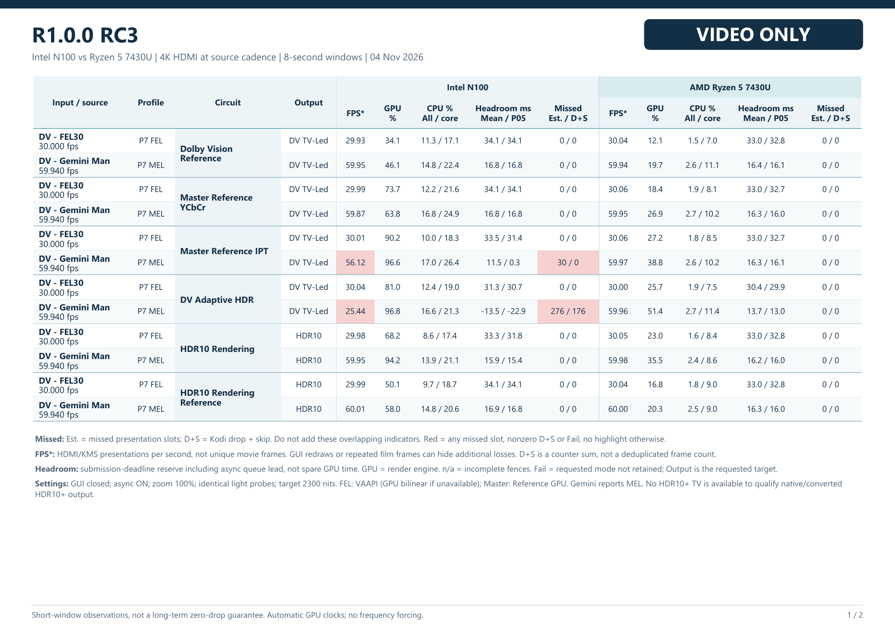
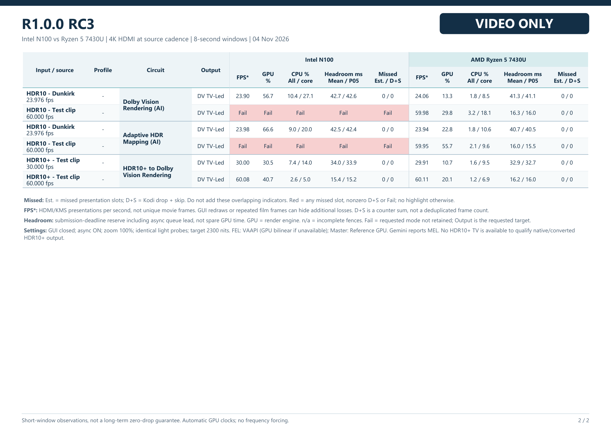

# RC3 playback benchmark

Intel N100 and AMD Ryzen 5 7430U running the same published **R1.0.0 RC3** image.
Measured on 4 November 2026, with the GUI closed.

[Download the two-page PDF](../reports/rc3/comparison.pdf) · [Measurements](../reports/rc3/measurements.json)

## Dolby Vision sources

## HDR10 and HDR10+ sources

## Reading the results

- **FPS:** HDMI/KMS presentations per second, not a count of distinct film frames.
- **GPU:** mean render-engine occupancy. Driver counters differ between Intel and AMD; this is not a directly comparable measure of total GPU work.
- **CPU All / core:** mean whole-system utilization across all logical CPUs, followed by the busiest logical CPU. These are not Kodi process percentages.
- **Headroom Mean / P05:** submission-deadline reserve in milliseconds, including asynchronous queue lead. It is **not spare GPU execution time**. P05 is the fifth percentile; negative values indicate late readiness.
- **Missed Est. / D+S:** estimated missed presentation slots and Kodi's drop-plus-skip counter delta. These overlap and must not be added together.
- **Fail:** the requested Dolby Vision circuit was not retained. An HDR10 fallback is not counted as successful Dolby Vision playback.

All 18 requested states ran at their expected cadence on the 7430U during the
measured windows. On N100, Master IPT and Adaptive were below the Gemini Man
59.94 fps cadence; the two HDR10 4K60 AI routes did not retain Dolby Vision.
These limitations are included rather than omitted from the report.

## Conditions and limits

The sources are 3840×2160, with 4K HDMI output at source cadence. Each case uses
the same source bytes on both machines and an eight-second observation window
after a common source-time gate. Async preparation is enabled; Master-to-Reference
fallback is disabled. Zoom and pixel ratio are 100%, subtitles are off, and
display-dependent modes use a 2300-nit target. Clocks remain automatic.

The FEL preference is VAAPI, with GPU bilinear when unavailable. Master uses its
Reference GPU filters. The Gemini Man sample reports Profile 7 MEL, not FEL.
HDR10+ → Dolby Vision is tested; native HDR10+ output and Dolby Vision → HDR10+
output are not qualified here because the connected TV does not support HDR10+.

Short windows reveal observed cadence and failures; they do not establish
whole-film stability, long-term thermal behavior or a universal zero-drop guarantee.
The downloadable measurements include source hashes, effective circuits and
outputs, CPU/GPU samples and deadline-margin samples.
