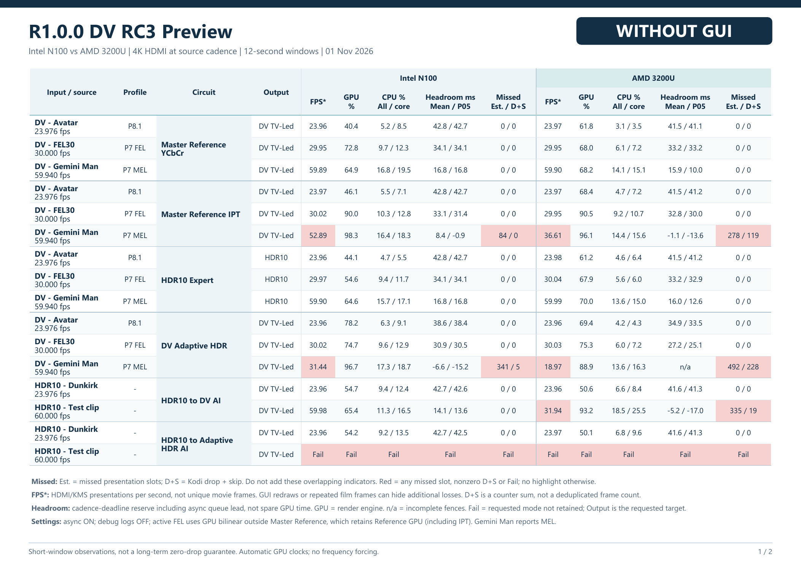
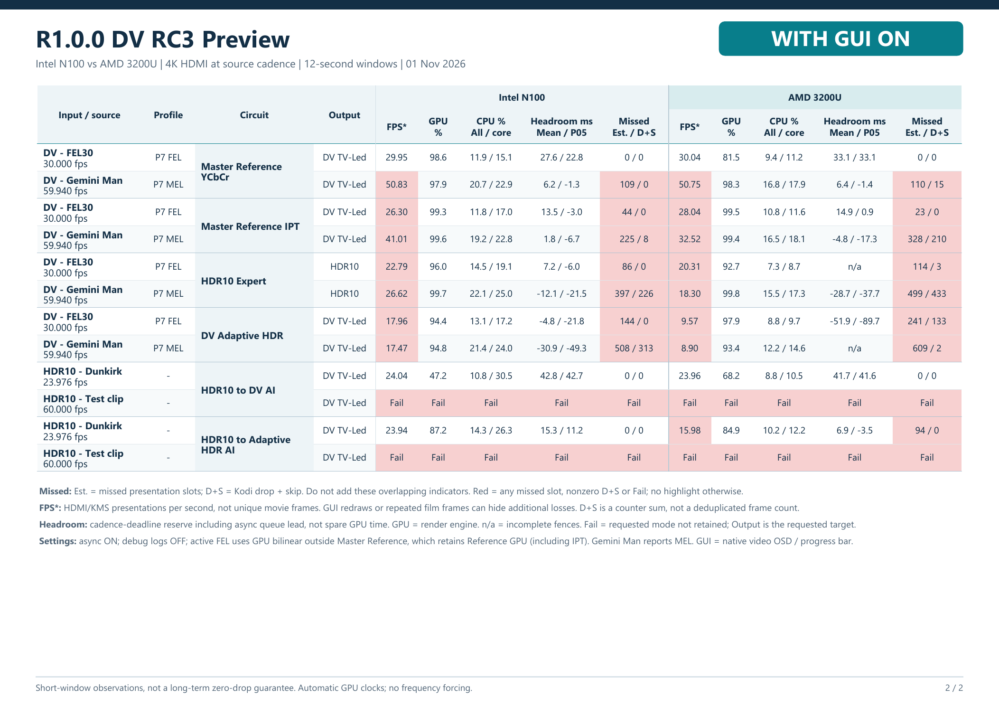

# Performance benchmarks

## R1.0.0 DV RC3 Preview

Intel N100 and AMD Ryzen 3 3200U, measured on 1 November 2026.
The two tables compare the CPUs side by side, without GUI first, then with
Kodi's playback OSD open.

- Sources: Dolby Vision Profile 8.1, Profile 7 FEL, Profile 7 MEL and HDR10.
- Modes: Master Reference YCbCr, Master Reference IPT, HDR10 Expert,
  DV Adaptive HDR, HDR10 to DV AI and HDR10 to Adaptive HDR AI.
- Metrics: presentation rate, rendering-engine load, total/busiest-core CPU load,
  headroom mean/P05 and missed frames.

### Without GUI

### With GUI ON

### Reading the results

**Red** marks missed presentation slots, nonzero Kodi drop/skip counters or
**Fail**. Fail means the requested mode was not active at the measurement
checkpoint; it does not necessarily mean Kodi crashed.

Estimated missed slots and Kodi's drop + skip total are separate, overlapping
indicators. Do not add them together. Presentation rate is HDMI/KMS updates per
second, not a count of unique movie frames. Headroom includes asynchronous
queue lead and is not unused GPU execution time.

The approximately 12-second windows describe these passages, not long-term
zero-drop guarantees. Missing internal fence observations are marked `n/a`.

### Settings

- 4K HDMI output at the source cadence; zoom and pixel ratio 100%.
- Async preparation on; enriched diagnostics and global debug off.
- FEL upscaling: GPU bilinear outside Master Reference. Both Master Reference
  YCbCr and IPT retain the reference GPU filter.
- GPU clocks remain automatic. Gemini Man reports Profile 7 MEL in this sample.

[Hardware support](HARDWARE.md)
