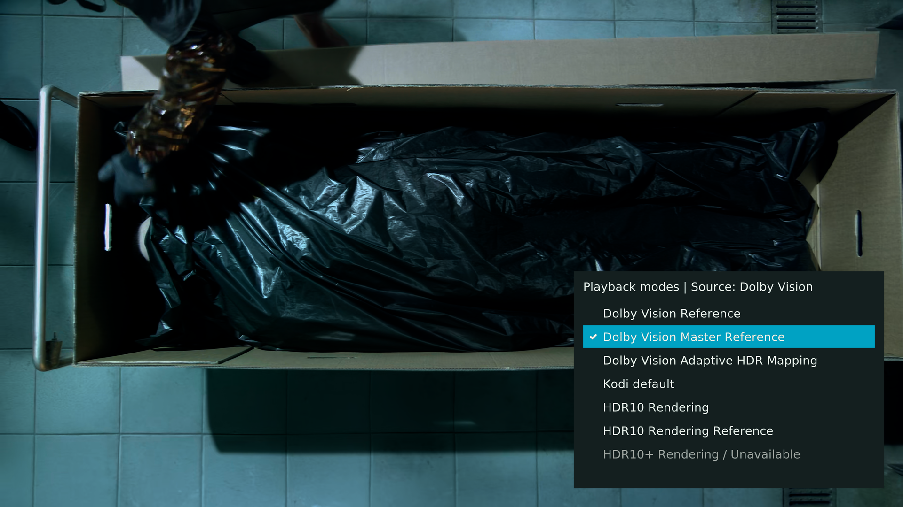
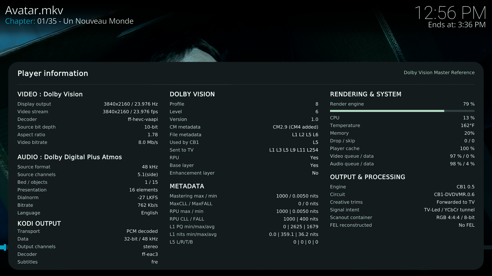

# Playback and settings

Open **Kodi > Settings > Player > Videos > CB1 - Dolby Vision engine**.
Only source-compatible rendering
modes appear during playback. Unavailable modes show their blocking reason.

| Source | Available processing |
| --- | --- |
| Dolby Vision | Reference, Master Reference, Adaptive HDR Mapping, HDR10 Rendering, HDR10 Rendering Reference, HDR10+ Rendering or Kodi default |
| HDR10 | Dolby Vision Rendering (AI), Adaptive HDR Mapping (AI) or Kodi default |
| HDR10+ | Kodi default for native HDR10+; Dolby Vision Rendering for metadata-guided conversion |
| SDR / HLG / 3D | Native Kodi playback |

The **Dolby Vision playback**, **HDR10 playback** and **HDR10+ playback** selectors
remember independent preferences. **Kodi default** bypasses CB1 image processing.
Automatic fallback does not overwrite the saved choice for the next file.

## TV profile

Configure the display characteristics for **Adaptive HDR Mapping**, including
the display peak in nits and the supported gamut. These
settings are hidden when the selected mode does not use them. The peak also
appears when a selected CM4 Auto/Auto 2 rule needs it; that does not enable
Adaptive processing in Reference or Master.

P3-D65 is the default gamut. Keep it unless the display profile calls for another
gamut. The configured peak is a processing reference, not a measurement made by
the player.

**HDR10 Rendering Reference** uses separate display calibration settings:
manual peak brightness (50–10000 nits), OLED/LCD/projector black-level presets or
a custom black level, and target gamut. Zero peak means not configured.
The black presets are estimates, not measurements of the display.
Disable the TV's dynamic tone mapping for this player-led mode to avoid a second
dynamic mapping stage. Dolby Vision output remains TV-Led: the TV still performs
its Dolby Vision display mapping.

[Compare FEL upscalers: VAAPI, Bilinear, Reference and former Nearest neighbour](FEL-UPSCALING.md).

## Rendering and Master recovery

Each mode uses one fixed rendering recipe. Reference and conversions retain
their qualified performance optimizations. Master Reference keeps its exact
reconstruction and dedicated filters. There is no quality On/Off/Auto selector.

**Allow Master Reference to switch to Reference** is off by default. When enabled,
sustained presentation margin below 2.5 ms can switch the current playback to
Reference. A notification confirms the accepted switch; the saved Master selection
is retained. GUI, capture, pause and discontinuous pictures are excluded from
the decision. Recovery state resets for a new video or manual mode change.

## FEL upscaling and frame preparation

At Expert level:

- **FEL upscaling**: VAAPI, Bilinear (GPU) or Reference (GPU). VAAPI falls back to
  GPU bilinear when unavailable. The enhancement layer is not discarded.
- **Asynchronous frame preparation**: enabled by default. Eligible CB1 modes
  prepare at most one next image while the current image is displayed. Changes
  apply to the next video. Native Kodi and fallback scheduling are unchanged.

Master Reference uses its own reference FEL filters, independently of the saved
FEL preference.

**Master Reference output**, at Expert level, selects YCbCr or IPT-PQc2 transport.
YCbCr is the default. Profile 5 keeps its direct IPT path in either Master output.

**Disable L2 trims** is an Expert option, off by default, for Reference and Master
Reference only. It removes outgoing L2 blocks without changing movie pixels or
source metadata. L8 remains active. Adaptive, AI and HDR conversions ignore it.

## CM2.9 to CM4 metadata

At Advanced level, select **Off**, **Only if source has no L2 trims**, **Always**,
**Auto** or **Auto 2** for Reference/Master. Off is the default.
The option adds compatible neutral CM4 blocks; it does not recover authored L8
trims or alter reconstructed pixels. Auto uses mastering brightness and its
selected trigger. Auto 2 uses scene L1 and TV peak, with 20% headroom by default.
The decision uses original L2 presence even when **Disable L2 trims** is enabled.
Both settings deliberately change outgoing metadata; leave both off to retain
the original Master metadata. [Conditions and defaults](../../CB1/docs/CM4-APPEND.md).

## Playback panels

Press **O**:

1. Player information.
2. Quick rendering selection, when applicable.
3. Video only.

Play/pause and seek remain available. Quick rendering selection is always
enabled. Disable **Enhanced Player information** to use Kodi's original panel
without removing the quick selector.

The quick selector uses Kodi controls in a compact bottom-right panel. Its height
follows the available modes; longer lists use native scrolling. Other selectors
keep the active skin's layout.

**Enhanced Player information** and **Show playback mode at start** are at Advanced
level. The startup notification is off by default and does not repeat on manual
mode changes.

GPU usage is Kodi's render-engine occupancy, including visible GUI. Unsupported
counters remain hidden. Source audio format and PCM/passthrough output are
reported separately.

The panel distinguishes file metadata, CB1 processing and metadata sent to the
TV, including live CM2.9-to-CM4 Auto/Auto 2 status.
Unknown audio fields are hidden. Atmos source metadata does not imply Atmos
output when Kodi decodes to PCM. [Audio field definitions](AUDIO-INFORMATION.md).

**Optimized GUI rendering** optionally reduces compositing work on compatible
Dolby Vision paths. Movie pixels and metadata are unchanged; very small GUI
differences are possible. Off keeps the existing rendering path.

## Geometry, scaling and display modes

Kodi owns the output resolution, refresh-rate whitelist, aspect ratio, zoom and
video rectangle. CB1 uses that geometry and Kodi's selected spatial filter;
there is no separate 1080p/1440p upscale option or custom bilinear selector.
Reconstruction and processing precede final spatial scaling and tunnel packing.
FEL upscaling is a separate enhancement-layer operation.

**Use encoded frame as Dolby Vision active area** is an explicit override for
already-cropped files with incorrect L5 margins. Off preserves authored margins;
it does not automatically correct aspect ratio. Kodi zoom and placement still apply.

**Normal** fits the picture using Kodi's normal aspect-ratio rules.
**Original size** keeps source-sized placement within the selected HDMI mode;
it does not request a matching HDMI resolution by itself. **Auto** avoids
unnecessary near-native UHD enlargement while retaining normal scaling for
smaller sources. Manual zoom remains available.

## Bitmap subtitles and Blu-ray menus

Native **Player > Subtitles** settings provide PGS/DVB brightness, saturation,
placement, vertical offset and size. Original colors, placement and 100% size
are the defaults. SDR and PQ authoring have separate color controls. Explicit
PGS authoring changes require subtitle reselection or reopening playback.
Disc-menu graphics and text subtitles are excluded.
Video-relative placement follows Kodi's video rectangle; encoded black bars
are not removed through a separate L5 interpretation.

Blu-ray navigation uses Kodi/libbluray. RC3 bundles the Java runtime and BD-J
JAR pair matching native libbluray 1.5.0; no separate Java add-on is required.
Disc-specific Java applications and repeated-disc memory behaviour are not
universally qualified. Menu compatibility depends on the disc application.

## AMD HDMI 3D

MVC Blu-ray ISO, side-by-side and top-and-bottom use native Kodi stereo controls,
not CB1 rendering modes. Configure **Playback mode of stereoscopic 3D videos**
under **Player > Videos** and the preferred output under **System > Display**.
[3D setup](3D.md).

## Refresh rate and diagnostics

Use Kodi's native **Adjust display refresh rate: On start/stop** and whitelist the
display's supported video modes. Native audio, subtitle and fallback controls
remain Kodi-owned.

Automatic diagnostics are recorded in `kodi.log`. Attach it to an issue with the
build version, CPU/GPU, display and HDMI route. No automatic upload is performed.
