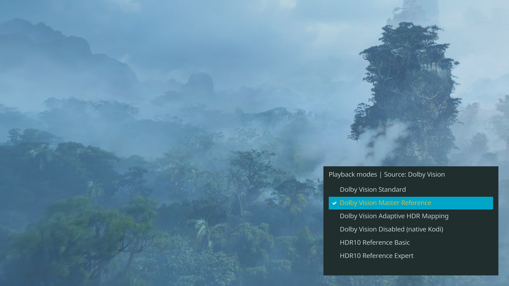
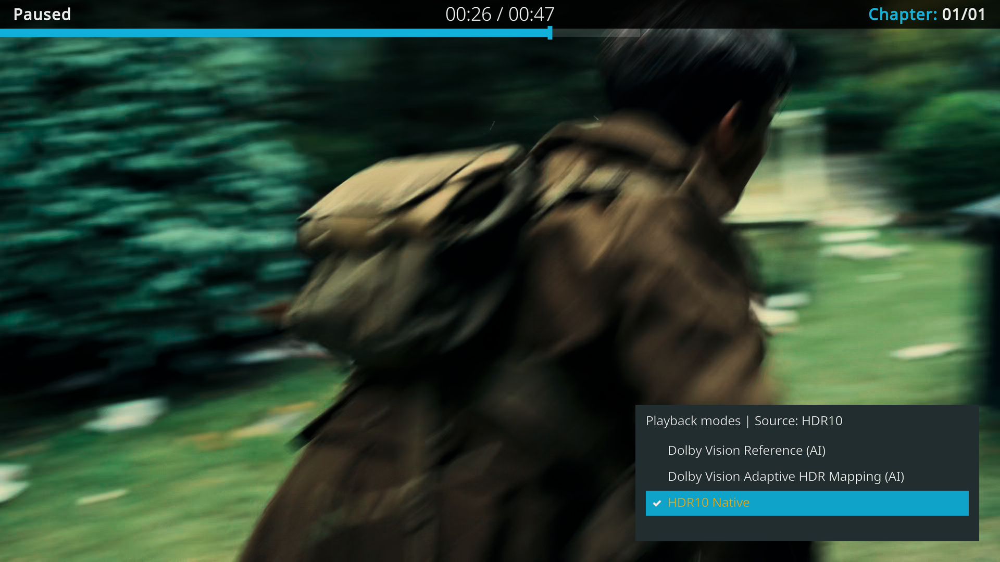

# Playback and settings

Open **Kodi > Settings > Player > Videos**. Only source-compatible rendering
modes appear during playback. Unavailable modes show their blocking reason.

## TV profile

Configure the display characteristics for **Adaptive HDR Mapping** or **HDR10
Expert**, including the display peak in nits and the supported gamut. These
settings are hidden when the selected mode does not use them.

P3-D65 is the default gamut. Keep it unless the display profile calls for another
gamut. The configured peak is a processing reference, not a measurement made by
the player.

For **HDR10 Expert**, disable the TV's dynamic tone mapping to avoid a second
dynamic mapping stage. Dolby Vision output remains TV-Led: the TV still performs
its Dolby Vision display mapping.

## Fast rendering

**Dolby Vision fast rendering** is at Advanced level, with **Off**, **On** and
**Auto**. Auto is the default and uses a 2.5 ms presentation-margin threshold.
Player information shows the effective state. Transitions are recorded in
`kodi.log`; the automatic state resets for each video.

| Mode | Fast behavior |
| --- | --- |
| Dolby Vision Standard | Always On, including when the saved preference is Off |
| Dolby Vision Master Reference | Always Off, including when the saved preference is On |
| Other eligible CB1 modes | Follow Off / On / Auto |
| Native Kodi / fallback | Unchanged |

In Auto, insufficient Master Reference presentation margin can switch the current
playback to Standard. A notification confirms the accepted switch; the saved
Master Reference selection is retained.

Fast uses a cheaper input-chroma interpolation path. Image differences are
usually very small and may be visible near fine colored edges or highlights.
It is not the reference reconstruction path.

## FEL upscaling and frame preparation

At Expert level:

- **FEL upscaling**: VAAPI or Nearest neighbour (GPU). Other modes can use the GPU
  path when VAAPI is unavailable. The enhancement layer is not discarded.
- **Asynchronous frame preparation**: enabled by default. Eligible CB1 modes
  prepare at most one next image while the current image is displayed. Changes
  apply to the next video. Native Kodi and fallback scheduling are unchanged.

Master Reference uses its own reference FEL filters, independently of the saved
VAAPI/Nearest preference.

## Playback panels

Press **O**:

1. Player information.
2. Quick rendering selection, when applicable.
3. Video only.

Play/pause and seek remain available. Quick rendering selection is always
enabled. Disable **Enhanced Player information** to use Kodi's original panel
without removing the quick selector.

**Enhanced Player information** and **Show playback mode at start** are at Advanced
level. The startup notification is off by default and does not repeat on manual
mode changes.

GPU usage is Kodi's render-engine occupancy, including visible GUI. Unsupported
counters remain hidden. Source audio format and PCM/passthrough output are
reported separately.

## AMD HDMI 3D

MVC Blu-ray ISO, side-by-side and top-and-bottom use native Kodi stereo controls,
not CB1 rendering modes. Configure **Playback mode of stereoscopic 3D videos**
under **Player > Videos** and the preferred output under **System > Display**.
[3D setup](3D.md).

## Refresh rate and diagnostics

Use Kodi's native **Adjust display refresh rate: On start/stop** and whitelist the
display's supported video modes. Native audio, subtitle and fallback controls
remain Kodi-owned.

Automatic diagnostics are recorded in `kodi.log`. Attach it to an issue with the
build version, CPU/GPU, display and HDMI route. No automatic upload is performed.
