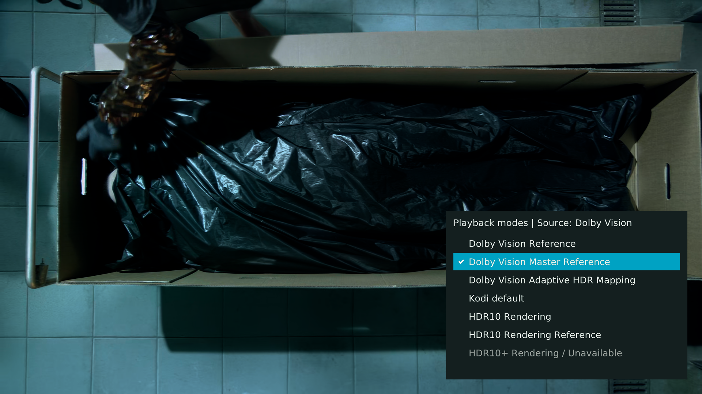
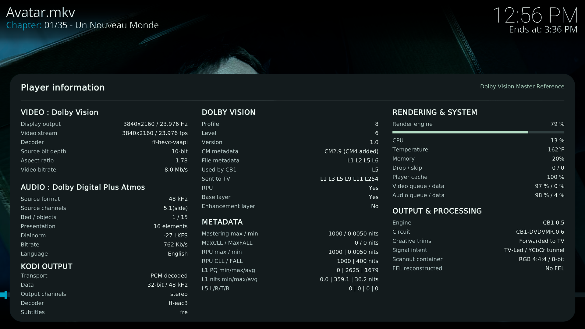

# Playback and settings

Open **Kodi > Settings > Player > Videos > CB1 - Dolby Vision engine**.
Only source-compatible rendering
modes appear during playback. Unavailable modes show their blocking reason.

| Source | Available processing |
| --- | --- |
| Dolby Vision | Reference, Master Reference, Adaptive HDR Mapping, HDR10 Rendering, HDR10 : LLDV Reference conversion, Dolby Vision : LLDV Reference, HDR10+ Rendering, SDR Rendering or Kodi default |
| HDR10 | Dolby Vision Rendering, Dolby Vision : Adaptive HDR Mapping, SDR Rendering or Kodi default |
| HDR10+ | HDR10+ Native, Kodi default for ordinary HDR10, Dolby Vision Rendering or SDR Conversion |
| HLG | HLG Native, Dolby Vision Rendering or SDR Conversion |
| SDR / 3D | Native Kodi playback |

The **Dolby Vision default playback**, **HDR10 default playback**, **HDR10+ default playback**
and **HLG default playback** selectors store independent defaults. Their right-hand
values show the saved choices, including the Dolby Vision conversion method.
Opening or reopening a file, restarting playback or advancing the playlist uses
that source's default. HLG-based Dolby Vision with RPU uses the Dolby Vision default.

Quick rendering selection through **O** or the video-settings button changes only
the current playback session. Pause, seek, decoder reopening and display recreation
retain that choice. These live choices never save over a default. Editing a default
during playback affects the next file; calibration and other tuning still apply live.
**Kodi default** uses native Kodi playback. An unavailable requested circuit shows
its reason and cannot silently switch to another circuit; preparation can remain pending.

## TV profile

Configure the display characteristics for **Adaptive HDR Mapping**, including
the display peak in nits and the supported gamut. These
settings are hidden when the selected mode does not use them. The peak also
appears when a selected CM4 Auto/Auto 2 rule needs it; that does not enable
Adaptive processing in Reference or Master.

P3-D65 is the default gamut. Keep it unless the display profile calls for another
gamut. The configured peak is a processing reference, not a measurement made by
the player.

**HDR10 : LLDV Reference conversion** uses separate display calibration settings:
manual peak brightness (50–10000 nits), OLED/LCD/projector black-level presets or
a custom black level, and target gamut. Zero peak means not configured.
The black presets are estimates, not measurements of the display.
Disable the TV's dynamic tone mapping for this HDR10 output to avoid a second
dynamic mapping stage.

**Dolby Vision : LLDV Reference** reads the peak, black level and primaries from the
active display's Dolby Vision EDID and sends a low-latency Dolby Vision signal.
The LLDV format selector shows the available HDMI transport and explains any
display or driver limitation.

[Compare FEL upscalers: VAAPI, Bilinear, Reference and former Nearest neighbour](FEL-UPSCALING.md).

## Rendering and Master diagnostics

Each mode uses one fixed rendering recipe. Reference and conversions retain
their qualified performance optimizations. Master Reference keeps its exact
reconstruction and dedicated filters. There is no quality On/Off/Auto selector.

Master Reference retains its requested circuit when rendering headroom is low.
Presentation-margin diagnostics remain available. GUI, capture, pause and
discontinuous pictures are excluded from those measurements.

**HDR/DV to SDR target** configures HDR10, HDR10+ and Dolby Vision conversion to
SDR, using BT.709 by default. It does not change native SDR playback.

## FEL upscaling and frame preparation

At Expert level:

- **FEL upscaling**: VAAPI, Bilinear (GPU) or Reference (GPU). VAAPI falls back to
  GPU bilinear when unavailable. The enhancement layer is not discarded.
Eligible CB1 modes prepare the next frame asynchronously when needed. Native
Kodi retains its own scheduling.

Master Reference uses its own reference FEL filters, independently of the saved
FEL preference.

**Master Reference output**, at Expert level, selects YCbCr or IPT-PQc2 transport.
YCbCr is the default. Profile 5 keeps its direct IPT path in either Master output.

**Disable L2 trims** is an Expert option, off by default, for Reference and Master
Reference only. It removes outgoing L2 blocks without changing movie pixels or
source metadata. L8 remains active. Adaptive, AI and HDR conversions ignore it.

## CM2.9 to CM4 metadata

At Advanced level, select **Off**, **Only if source has no L2 trims**, **Always**,
**Auto** or **Auto 2** for Reference/Master. Off is the default.
The option adds compatible neutral CM4 blocks; it does not recover authored L8
trims or alter reconstructed pixels. Auto uses mastering brightness and its
selected trigger. Auto 2 uses scene L1 and TV peak, with 20% headroom by default.
The decision uses original L2 presence even when **Disable L2 trims** is enabled.
Both settings deliberately change outgoing metadata; leave both off to retain
the original Master metadata. [Conditions and defaults](../../CB1/docs/CM4-APPEND.md).

## Playback panels

Press **O**:

1. Player information.
2. Quick rendering selection, when applicable.
3. Video only.

Play/pause and seek remain available. Quick rendering selection is always
enabled. Disable **Enhanced Player information** to use Kodi's original panel
without removing the quick selector.

The quick selector uses Kodi controls in a compact bottom-right panel. Its height
follows the available modes; longer lists use native scrolling. Other selectors
keep the active skin's layout.

**Enhanced Player information** and **Show playback mode at start** are at Advanced
level. The startup notification is off by default and does not repeat on manual
mode changes.

GPU usage is Kodi's render-engine occupancy, including visible GUI. Unsupported
counters remain hidden. Source audio format and PCM/passthrough output are
reported separately.

The panel distinguishes file metadata, CB1 processing and metadata sent to the
TV, including live CM2.9-to-CM4 Auto/Auto 2 status.
Unknown audio fields are hidden. Atmos source metadata does not imply Atmos
output when Kodi decodes to PCM. [Audio field definitions](AUDIO-INFORMATION.md).

GUI compositing optimizations apply automatically on eligible CB1 paths through
their existing capability and safety checks. Movie pixels and metadata are unchanged.

## Geometry, scaling and display modes

Kodi owns the output resolution, refresh-rate whitelist, aspect ratio, zoom and
video rectangle. **Upscaler – 1080p and above** and **Upscaler – below 1080p**
select a spatial filter by source resolution, including for HDR and Dolby Vision.
The first setting applies from 1920 pixels wide or 1080 pixels high, so it also
covers cropped 1080p films. Both start at **Kodi default**, which
uses the existing video scaling preference, including per-title settings. A new
Kodi profile uses bilinear. The separate **Auto** choice uses Kodi's automatic
filter selection. Player Information shows the effective filter when the video
is enlarged.

The two menus offer the same filters, including FSR 1 EASU, EASU + RCAS,
FSRCNNX x2 and Anime4K Fast. Shader presets run for supported texture, colour
and geometry combinations. Outside Master Reference, an unavailable combination
uses the configured Kodi scaler. The panel reports the applied filter. RCAS is
a separate sharpening pass after EASU.

Dolby Vision Master Reference runs EASU + RCAS, FSRCNNX, and Anime4K Fast in
its final spatial pass, before overlays and tunnel packing. FSRCNNX processes
the reconstructed luma and preserves the two opponent channels. The output
texture keeps Master Reference precision. An upscaler that fails to render
does not report itself as applied.

Reconstruction and processing precede final spatial scaling and tunnel packing.
FEL upscaling is a separate enhancement-layer operation.

Dolby Vision processing respects authored L5 active-area margins, including when an
old configuration saved the former encoded-frame override. Kodi zoom and placement
still apply; no automatic aspect-ratio correction is inferred.

**Normal** fits the picture using Kodi's normal aspect-ratio rules.
**Original size** keeps source-sized placement within the selected HDMI mode;
it does not request a matching HDMI resolution by itself. **Auto** avoids
unnecessary near-native UHD enlargement while retaining normal scaling for
smaller sources. Manual zoom remains available.

## Bitmap subtitles and Blu-ray menus

Native **Player > Subtitles** settings provide PGS/DVB brightness, saturation,
placement, vertical offset and size. Original colors, placement and 100% size
are the defaults. SDR and PQ authoring have separate color controls. Explicit
PGS authoring changes require subtitle reselection or reopening playback.
Disc-menu graphics and text subtitles are excluded.
Video-relative placement follows Kodi's video rectangle; encoded black bars
are not removed through a separate L5 interpretation.

A UHD disc authors its menu graphics in the dynamic range of the video they
accompany. While the play item carries HDR10 or Dolby Vision video, BD-J and
HDMV menu graphics are read as BT.2020 PQ, as the disc authored them, and drawn
with the PQ bitmaps: straight into Kodi's HDR output, into the PQ subtitle layer
of the Dolby Vision circuits, or converted to sRGB for SDR output. Their
brightness and colour are therefore the disc's own, for example about 283 nits
for The Call of the Wild's menu text and about 409 nits for Avatar: Fire and
Ash's. Menus over SDR video are unchanged.

Blu-ray navigation uses Kodi/libbluray. RC3 bundles the Java runtime and BD-J
JAR pair matching native libbluray 1.5.0; no separate Java add-on is required.
Disc-specific Java applications and repeated-disc memory behaviour are not
universally qualified. Menu compatibility depends on the disc application.

## AMD HDMI 3D

MVC Blu-ray ISO, side-by-side and top-and-bottom use native Kodi stereo controls,
not CB1 rendering modes. Configure **Playback mode of stereoscopic 3D videos**
under **Player > Videos** and the preferred output under **System > Display**.
[3D setup](3D.md).

## Refresh rate and diagnostics

Use Kodi's native **Adjust display refresh rate: On start/stop** and whitelist the
display's supported video modes. Native audio, subtitle and fallback controls
remain Kodi-owned.

Automatic diagnostics are recorded in `kodi.log`. Attach it to an issue with the
build version, CPU/GPU, display and HDMI route. No automatic upload is performed.

## SDR rendering target

SDR Rendering reconstructs the original Dolby Vision base, applicable enhancement/FEL
and RPU before mapping to SDR. HDR10/HDR10+ use their original decoded image.
**SDR output gamut** defaults to BT.709. BT.2020 is available when the active HDMI
driver and display advertise BT.2020 RGB. If the output rejects it, playback
renders a fresh BT.709 frame. Player Process Info shows the accepted gamut, peak
and gamma. The output carries no Dolby Vision, HDR10 or HDR10+ metadata.

The independent SDR target offers Reference (100 nits, gamma 2.4), Bright room
(200 nits, gamma 2.2), or Custom / Projector. Custom peak is 20–500 nits,
gamma 1.8–2.8 and black floor 0–5 nits below the peak. These are rendering
targets, not measurements of the screen. HDR calibration is preserved separately.

Plain HLG offers native playback, Dolby Vision Rendering and SDR Conversion. The reference
path normalizes original HLG with the BT.2100 1000-nit / gamma 1.2 reference
before analysis; it does not invent authored L2/L8 trims. HLG-base Dolby Vision
P8.4/P10.4 with RPU remains Dolby Vision and retains full reconstruction.

### Dolby Vision LLDV format selection

Open **Dolby Vision default playback** and select **Dolby Vision : LLDV Reference**.
The format selector lists HDMI formats and a reason for unavailable choices.
Automatic keeps the driver and TV compatibility checks. Player Information
reports the format actually committed, including the experimental indicator
for forced 4:2:2. The TV characteristics group shows the target peak and black
level read from the Dolby Vision EDID.

On supported HDMI paths, choose **4:2:2 10-bit** explicitly when the selector
labels it forced and experimental. Automatic prefers native 10-bit, then
a compatible 12-bit transport. The driver checks the display and timing for each LLDV
commit. The Ryzen 5 7430U path at UHD 23.976/24 Hz carries 10 useful bits in a
12-bit HDMI carrier.
