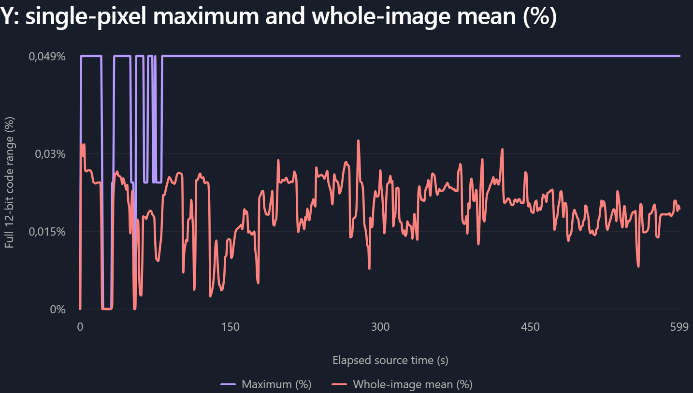
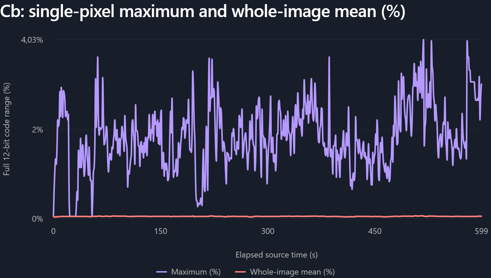
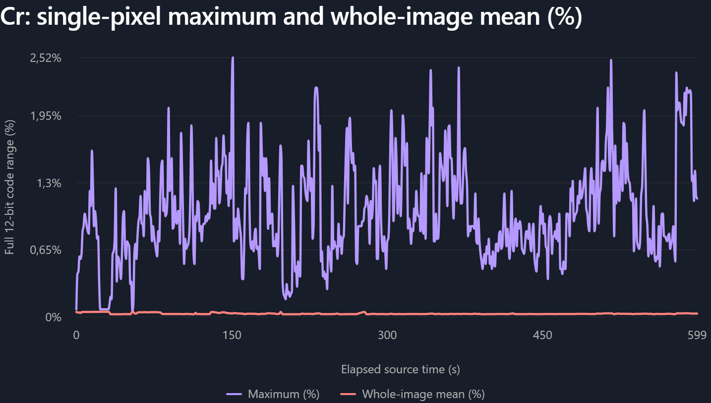
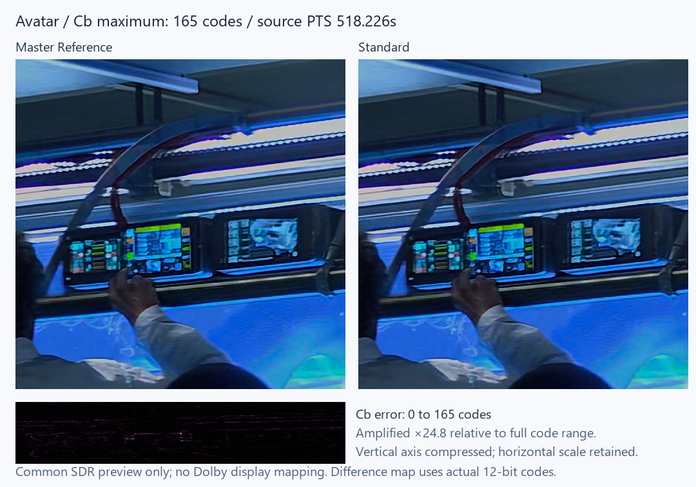
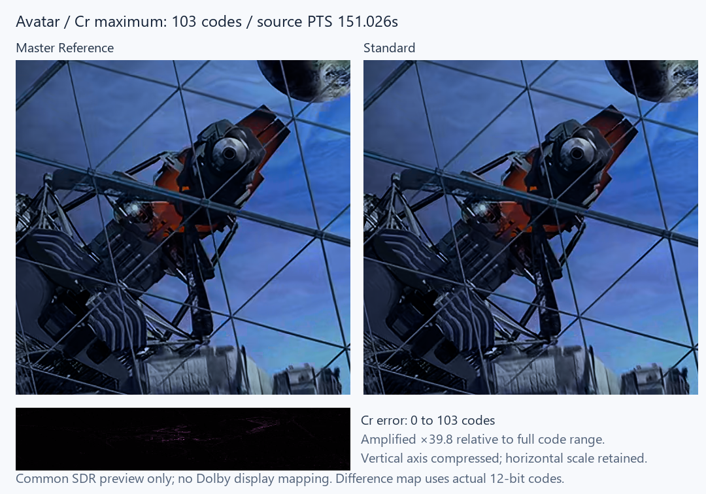
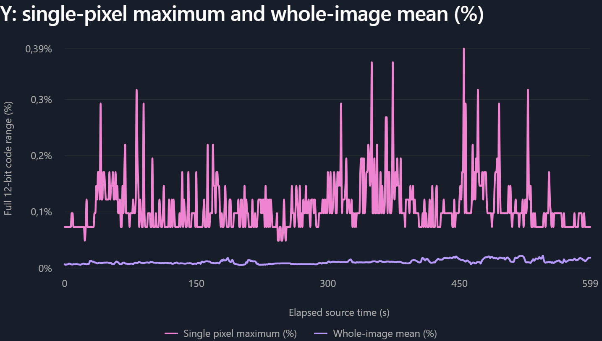
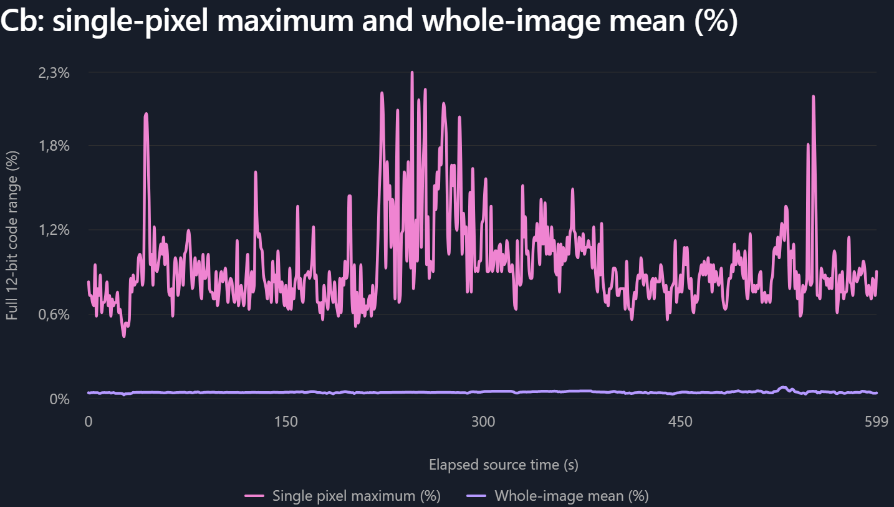
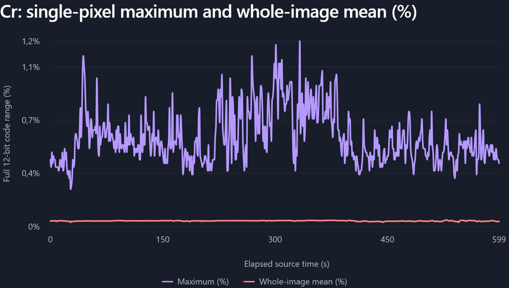
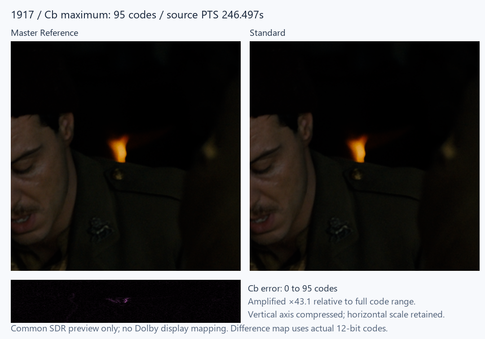
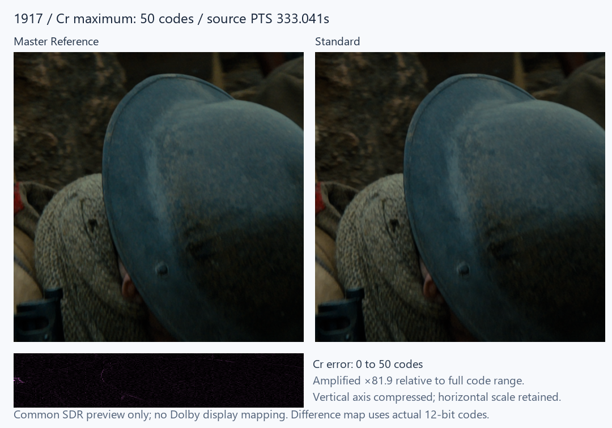

# Master Reference vs Standard: image fidelity and GPU performance

Standard makes small, intended-to-be near-imperceptible image trade-offs to increase rendering efficiency. This comparison measures their size and location against Master Reference, alongside GPU load and GPU work per video frame.

Measured on an AMD Ryzen 5 7430U, LibreELEC DV R1.0.0 Beta5 Debug. The rendering code was not modified for the comparison.

## Results at a glance

| Source | GPU load reduction | GPU time saved per frame |
|---|---:|---:|
| Avatar | 34.0% | 1.889 ms |
| 1917 | 50.2% | 4.068 ms |

GPU busy time per frame is calculated from the measured GFX engine load and the 41.708 ms source-frame period. It describes GPU work, not isolated shader latency or the wall-clock duration of one render call.

## Playback performance

Two matched 90-second windows per mode and source, starting at 120 s and 330 s within each excerpt. Async On, no GUI or subtitles. Master Reference uses its reference path; Standard uses its forced Fast path. Display refresh was approximately 23.98 Hz.

| Source | Mode | GFX load | GPU busy time / frame | Missed presentations |
|---|---|---:|---:|---:|
| Avatar | Master Reference | 13.31% | 5.550 ms | 0 |
| Avatar | Standard | 8.78% | 3.661 ms | 0 |
| 1917 | Master Reference | 19.44% | 8.107 ms | 0 |
| 1917 | Standard | 9.68% | 4.039 ms | 0 |

Missed presentations come from the DRM/fence observer, not an unavailable Kodi GUI counter. Startup and seeking are excluded.

## Image comparison

Each source covers 600 continuous source seconds and 14,386 decoded frames at 24000/1001 fps. Every useful-picture component sample is compared, without temporal or pixel sampling. Master Reference is the comparison baseline, not an independently certified reference player.

Differences below are absolute 12-bit Y, Cb and Cr code differences. Percentages use the full digital code range: `absolute difference / 4095 × 100`. They are not percentages of brightness, perceptual colour difference or image-quality loss.

### Avatar

Profile 8.1, no enhancement layer.

| Component | Mean error (codes) | Mean (% of range) | p99.9 (codes) | Maximum (codes) | Maximum (% of range) | Samples above 16 codes |
|---|---:|---:|---:|---:|---:|---:|
| Y | 0.788 | 0.0192% | 2 | 2 | 0.049% | 0.00000% |
| Cb | 2.014 | 0.0492% | 17 | 165 | 4.029% | 0.10230% |
| Cr | 1.255 | 0.0307% | 7 | 103 | 2.515% | 0.01170% |

Maximum: the largest error on a single pixel, not an error affecting the whole image. In 4:2:2, each Cb/Cr sample is shared by two adjacent pixels. Whole-image mean: the mean absolute error across the entire useful image. Each point includes every frame within one source second; the mean is pixel-weighted and the maximum retains every error spike. Both curves are percentages of the full 12-bit code range. Letterbox and metadata-carrier rows are excluded. Each component has its own vertical scale, beginning at zero.

#### Largest colour differences

The largest excursions are concentrated around blue strip lighting and fine red/blue equipment edges.

Cb maximum at excerpt PTS 518.226 s, raster coordinate (2406, 505).

Cr maximum at excerpt PTS 151.026 s, raster coordinate (2382, 969).

### 1917

Profile 7 FEL. The enhancement layer is decoded and reconstructed on every compared frame.

| Component | Mean error (codes) | Mean (% of range) | p99.9 (codes) | Maximum (codes) | Maximum (% of range) | Samples above 16 codes |
|---|---:|---:|---:|---:|---:|---:|
| Y | 0.456 | 0.0111% | 2 | 16 | 0.391% | 0.00000% |
| Cb | 1.849 | 0.0452% | 11 | 95 | 2.320% | 0.00940% |
| Cr | 1.492 | 0.0364% | 7 | 50 | 1.221% | 0.00034% |

Maximum: the largest error on a single pixel, not an error affecting the whole image. In 4:2:2, each Cb/Cr sample is shared by two adjacent pixels. Whole-image mean: the mean absolute error across the entire useful image. Each point includes every frame within one source second; the mean is pixel-weighted and the maximum retains every error spike. Both curves are percentages of the full 12-bit code range. Letterbox and metadata-carrier rows are excluded. Each component has its own vertical scale, beginning at zero.

#### Largest colour differences

The largest excursions occur at a small warm highlight/face-lapel transition and a helmet/fabric edge.

Cb maximum at excerpt PTS 246.497 s, raster coordinate (2148, 869).

Cr maximum at excerpt PTS 333.041 s, raster coordinate (0, 1605).

## Theoretical visual impact

Most differences are very small and unnoticeable. They do not imply a whole-scene brightness change. Y errors are substantially smaller than the largest chroma errors.

The side-by-side crops use one common illustrative SDR transform, not the TV's Dolby Vision display mapping. Difference strips use the actual transport-output code errors and are deliberately amplified. Their brightness is not the visible strength of the defect.

No panel capture, perceptual threshold, colourimeter measurement or certified-player comparison was performed. The numerical results support small typical errors and lower GPU work, but cannot guarantee that every local difference is invisible on every TV.

## Protocol and scope

- Avatar: 3840×2160 Profile 8.1, first ten minutes of the full source.
- 1917: 3840×2160 Profile 7 FEL remux, ten-minute lossless video copy beginning near the selected random-access point at the ten-minute source position. Excerpt timestamps in this report are relative to that copy.
- Both modes receive the same decoded BL frame, exact matching EL where present, and original RPU. Master uses reference FEL filtering. Standard uses its normal optimized path.
- On this 7430U, Y416 FEL VAAPI processing is unsupported, so Standard uses its existing shader fallback. These measurements do not establish the performance of another GPU's VAAPI path.
- The actual transmitted colour transforms and all serialized creative metadata blocks, including L5, match between both outputs on every compared frame. This does not mean their picture samples match.
- L5 letterbox areas and the first four metadata-carrier rows are excluded from picture histograms. Y counts one sample per pixel; Cb and Cr each count one sample per 4:2:2 pair.
- Complete 4096-bin histograms produce exact means, maxima and p99.9 values. The measurement-only GPU histogram was checked against independent CPU unpacking. Capture/readback overhead is excluded from normal playback performance measurements.
- Two missing preroll timestamps introduced by the private 1917 excerpt operation were recovered from FFmpeg HEVC picture order. Compressed pictures and Dolby metadata were not changed.
- Performance uses Kodi's DRM GFX busy counters and accepted presentation/fence timing. Decode engine load is not added to GFX load. Trace buffers had no overrun and each window had at least 90% presentation coverage.
- One playback window that overlapped evidence transfer was excluded and repeated without that transfer. All retained windows use the same protocol.
- Temporary playback settings and measurement observers were removed or restored. No Intel measurements or rendering changes are included.

## Data

- [Reviewed results and metric definitions](master-standard-20261021/results.json)

- [Per-second maximum error curves](master-standard-20261021/maximum-errors.csv)

- [Per-frame Avatar errors](master-standard-20261021/avatar-frames.csv)

- [Per-frame 1917 errors](master-standard-20261021/1917-frames.csv)

The evidence contains numerical errors and selected analytical crops, not downloadable movie excerpts.
